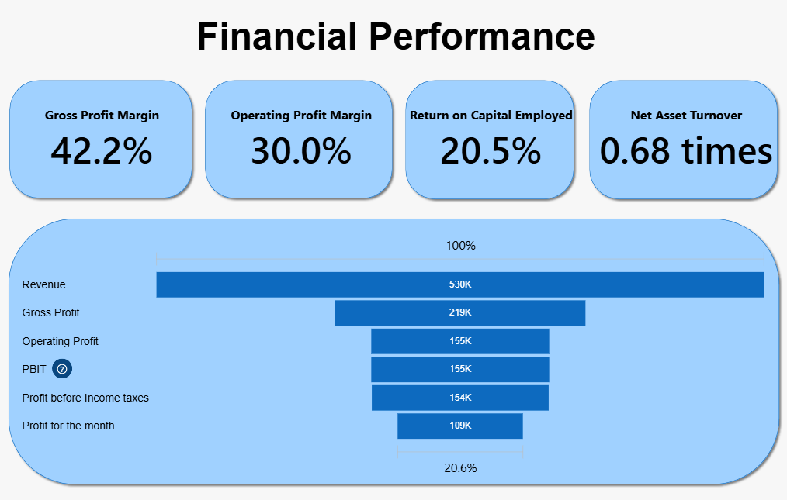
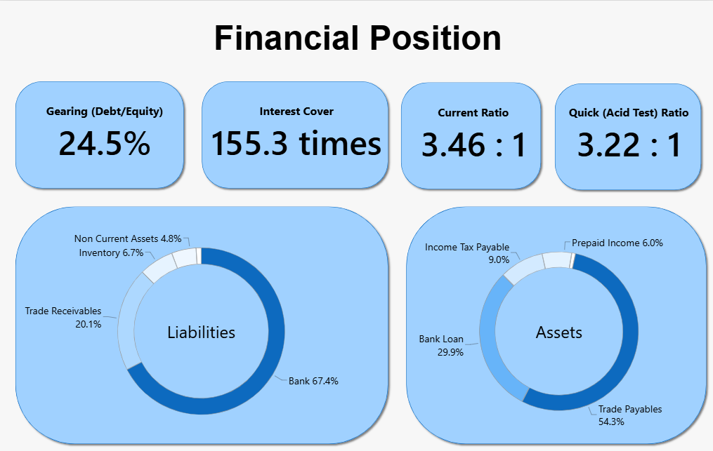

# NorthStar Trading Ltd. — Financial Dashboard (Power BI)

A financial reporting and visualization project built in **Microsoft Power BI** using financial statements generated from an end-to-end simulated bookkeeping project for a fictional UK private company engaged in B2B technology equipment distribution.

The project uses **Power Query** to transform, filter, and restructure financial statement data into a consistent format for visualization.

> **Portfolio project:** This is a fictional educational project and does not represent employment or client work.
> 

---

## Project Overview

| Item | Details |
| --- | --- |
| Company | NorthStar Trading Ltd. |
| Industry | B2B Technology Equipment Distribution |
| Legal Form | UK private company |
| Currency | USD |
| Reporting Period | January 2026 |
| Tools | Microsoft Power BI, Power Query |
| Project Type | Simulated financial reporting project |

---

## Objective

To convert financial statement data from an end-to-end bookkeeping project into visual summaries using Power BI, demonstrating practical skills in data transformation, reporting, and financial data presentation.

**Source project:** 

---

## Dashboard

The report presents a visual summary of the company's financial position and performance for January 2026.

### Financial Performance

### Financial Position

The visuals include:

- **Cards** to display key financial figures.
- **Donut charts** to show the composition of selected financial categories.
- **Funnel chart** to illustrate how profit changes between the Revenue figure and Profit for the month value.

---

## Power BI and Power Query Techniques

### Power Query

- **Append Queries:** Combined data from multiple tables where required.
- **Reference Queries:** Created derived queries from existing data.
- **Pivot Column:** Restructured data into a format suitable for reporting.
- **Data Type Conversion:** Assigned appropriate data types, including whole numbers and percentages where applicable.

### Power BI

- Designed a dashboard layout for financial data presentation.
- Used cards, donut charts, and a funnel chart to communicate financial information visually.

---

## Key Learning Outcomes

- Transformed financial statement tables into structured datasets suitable for visualization.
- Derived a categorized view of asset and liability balances from the Statement of Financial Position.
- Organized profit and expense figures from the Statement of Profit or Loss for visual comparison.
- Gained practical experience preparing accounting data for reporting using Power Query and Power BI.

---

## Project Files

| File | Description |
| --- | --- |
| `northstar_trading_dashboard.pbix` | Power BI report file |

---

## Disclaimer

NorthStar Trading Ltd. is a fictional company created solely for educational and portfolio purposes. The figures and reports are simulated and do not represent an actual business or client engagement.

This project is for educational demonstration and should not be interpreted as professional accounting advice.

---

## Copyright

© 2026 Muhammad Sami. All rights reserved.

Please obtain permission before reproducing or redistributing this work or presenting it as your own.
